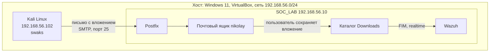
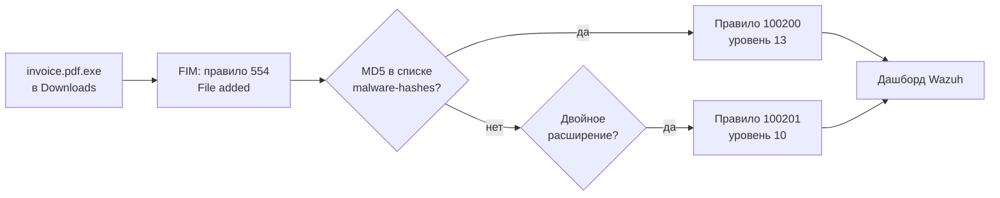

# SOC_LAB (phishing)

Домашний SOC-стенд на базе Wazuh. В этом проекте разбирается обнаружение фишингового письма с вредоносным вложением. С атакующей машины Kali Linux отправляется письмо, пользователь на сервере Ubuntu сохраняет вложение, а Wazuh опознаёт файл по хэшу и поднимает алерт с привязкой к техникам MITRE ATT&CK T1566.001 и T1204.002.

---

## Цель

Фишинг является одним из самых распространённых способов первичного проникновения, поэтому было решено пройти всю цепочку целиком. Письмо доставляется, пользователь сохраняет вложение, файл появляется на диске, Wazuh сверяет его хэш со списком известных вредоносных файлов, и на дашборде появляется алерт. Именно такую картину и видит аналитик SOC в реальной работе.

Вместо настоящего вируса используется тестовый файл EICAR. Он безопасен и придуман как раз для проверки средств защиты.

---

## Стенд

| Машина | ОС и ПО | IP (Host-Only) | Роль |
|---|---|---|---|
| SOC_LAB | Ubuntu Server 26.04.1 LTS, Wazuh 4.14.8, Postfix, mutt | 192.168.56.10 | SIEM, почтовый сервер, рабочее место пользователя |
| Kali | Kali Linux 2025.4, swaks | 192.168.56.102 | атакующая машина |

Обе машины работают в VirtualBox на хосте с Windows 11 и соединены изолированной сетью Host-Only 192.168.56.0/24. Почтовый сервер принимает письма только из этой сети и наружу ничего не отправляет, так что весь сценарий остаётся внутри стенда.

Схема атаки:



Путь события от сохранения файла до алерта:



Развёртывание стенда описано в docs/deployment.md.

---

## Результат

Вложение invoice.pdf.exe обнаруживается сразу, как только пользователь сохраняет его на диск. Хэш файла совпадает с записью в списке malware-hashes, поэтому срабатывает правило 100200 уровня 13 с привязкой к T1566.001 (Spearphishing Attachment) и T1204.002 (Malicious File). А что с файлами, которых в списке нет? Для них есть правило 100201: так, например, файл report.docx.exe был выявлен по двойному расширению. Кроме того, журнал почтового сервера позволяет связать алерт с конкретным письмом от billing@invoice-portal.test.

Подробный разбор со скриншотами лежит в scenarios/01-phishing/README.md, а порядок повторения сценария в scenarios/01-phishing/runbook.md.

---

## Собственные компоненты Wazuh

| Файл | Назначение |
|---|---|
| lists/malware-hashes | CDB-список хэшей известных вредоносных файлов |
| rules/local_rules.xml | правило 100200 (хэш из списка) и правило 100201 (двойное расширение) |

---

## Структура репозитория

```
soc-lab-phishing/
├── README.md
├── docs/
│   ├── deployment.md
│   └── screenshots/
├── scenarios/
│   └── 01-phishing/
│       ├── README.md
│       ├── runbook.md
│       └── screenshots/
├── lists/
│   └── malware-hashes
└── rules/
    └── local_rules.xml
```
