# Сценарий 1. Фишинговое письмо с вредоносным вложением

Техники MITRE ATT&CK: T1566.001, Spearphishing Attachment (тактика Initial Access), и T1204.002, Malicious File (тактика Execution).

Статус: реализовано.

---

## Цель сценария

Фишинг до сих пор остаётся одним из самых частых способов попасть в корпоративную сеть. Схема почти всегда одна и та же: пользователю приходит письмо с вложением, которое выглядит как обычный документ, он его сохраняет и открывает. В этом сценарии мы воспроизводим такую атаку на стенде и смотрим, сможет ли Wazuh заметить вредоносный файл в момент, когда он появляется на диске.

Вместо настоящего вируса используется тестовый файл EICAR. Это стандартная строка для проверки средств защиты: антивирусы и SIEM считают её вредоносной, но никакого исполняемого кода внутри нет. Так что опасности для стенда никакой. Отправитель письма вымышленный, а домен .test зарезервирован специально для тестов и никому не принадлежит.

---

## Исходные данные

| Параметр | Значение |
|---|---|
| Атакующий (Kali Linux 2025.4) | 192.168.56.102, отправка письма утилитой swaks |
| Жертва (SOC_LAB, Ubuntu Server 26.04.1) | 192.168.56.10, пользователь nikolay |
| Почтовый сервер | Postfix на SOC_LAB, только локальная доставка |
| Почтовый клиент | mutt |
| SIEM | Wazuh 4.14.8 на SOC_LAB |
| Отправитель письма | billing@invoice-portal.test |
| Вложение | invoice.pdf.exe (тестовый файл EICAR, 68 байт) |

Все машины находятся в изолированной сети Host-Only, поэтому письмо никуда за пределы стенда не уходит.

---

## Шаг 1. Почтовый сервер

Для начала нужен почтовый сервер, иначе письму просто некуда приходить. На SOC_LAB был установлен Postfix в режиме локальной доставки и консольный клиент mutt. Сервер принимает почту только из сети стенда 192.168.56.0/24 и раскладывает её по локальным почтовым ящикам. Порт 25 в файрволе открыт тоже только для этой сети (рисунок 1).

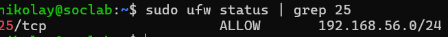

Рисунок 1 — Порт 25 открыт только для сети стенда

---

## Шаг 2. Контроль каталога загрузок

Дальше нужно, чтобы Wazuh видел, что происходит в папке загрузок пользователя. Для этого используется модуль контроля целостности файлов, FIM. Он настроен на каталог /home/nikolay/Downloads в режиме реального времени, то есть реагирует сразу, а не во время плановой проверки раз в несколько часов. Параметр check_all включает подсчёт хэшей MD5, SHA1 и SHA256 для каждого нового файла, что в свою очередь и позволяет потом опознать файл.

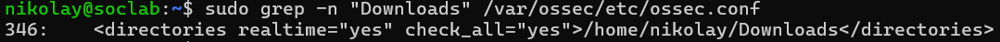

Рисунок 2 — Каталог Downloads добавлен в FIM с режимом realtime

---

## Шаг 3. Список вредоносных хэшей

Как Wazuh поймёт, что файл именно вредоносный? Для этого используется CDB-список, по сути небольшая база известных хэшей. В нашем случае в ней одна запись: MD5 тестового файла EICAR (файл lists/malware-hashes в этом репозитории).

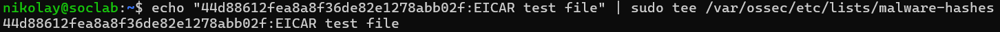

Рисунок 3 — Список /var/ossec/etc/lists/malware-hashes

Список подключается в основном блоке ruleset конфигурации ossec.conf, рядом со стандартными списками Wazuh. На рисунке 4 видно его в строке 270, а в строке 347 каталог Downloads из предыдущего шага.

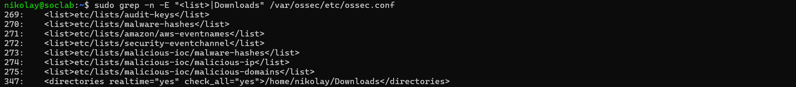

Рисунок 4 — Список malware-hashes в блоке ruleset и каталог Downloads в блоке syscheck

---

## Шаг 4. Правила обнаружения

Сам по себе список ничего не делает, нужны правила. В /var/ossec/etc/rules/local_rules.xml было добавлено два правила (файл rules/local_rules.xml в этом репозитории), они описаны в таблице ниже.

| Правило | Уровень | Условие | MITRE |
|---|---|---|---|
| 100200 | 13 | хэш нового файла есть в списке malware-hashes | T1566.001, T1204.002 |
| 100201 | 10 | у нового файла двойное расширение, например .pdf.exe | T1566.001 |

Оба правила являются дочерними для штатного правила FIM 554 (File added to the system). Тут есть одна особенность: на одно событие Wazuh создаёт только один алерт. Поэтому первым проверяется правило по хэшу, и известный вредоносный файл сразу получает уровень 13. Правило по имени срабатывает в тех случаях, когда хэша в списке нет, но файл всё равно выглядит подозрительно.

---

## Шаг 5. Подготовка вложения на Kali

Перейдём к атакующей стороне. На Kali создаётся файл invoice.pdf.exe со строкой EICAR. Имя выбрано не просто так: двойное расширение рассчитано на то, что пользователь увидит в имени только pdf и не обратит внимания на exe в конце.

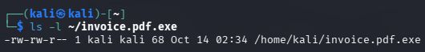

Рисунок 5 — Файл invoice.pdf.exe размером 68 байт

Хэш файла совпадает со значением из списка на сервере (рисунок 6). Это важно, ведь даже один лишний символ, например перевод строки, полностью меняет хэш.

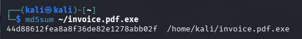

Рисунок 6 — MD5 файла совпадает со значением из списка malware-hashes

---

## Шаг 6. Отправка письма

Письмо с вложением отправляется на почтовый сервер SOC_LAB утилитой swaks. Она показывает весь диалог с сервером, довольно удобно для проверки.

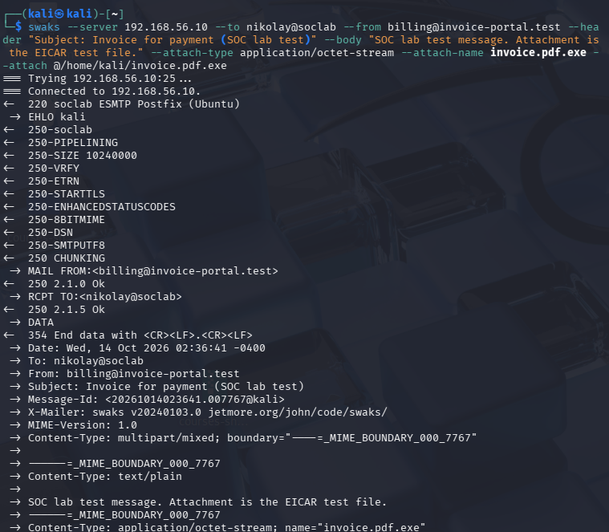

Рисунок 7 — Диалог с почтовым сервером: отправитель billing@invoice-portal.test, получатель nikolay@soclab, вложение invoice.pdf.exe

Что письмо действительно дошло, подтверждает журнал Postfix на сервере. В нём видны отправитель и статус доставки в почтовый ящик (рисунок 8).

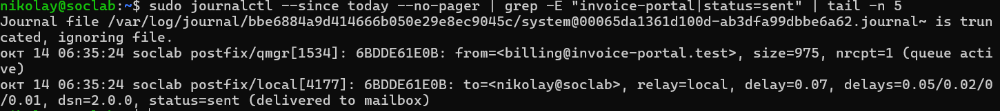

Рисунок 8 — Письмо от billing@invoice-portal.test доставлено в почтовый ящик пользователя (status=sent)

---

## Шаг 7. Действия пользователя

Теперь роль жертвы. Пользователь открывает почтовый клиент и видит письмо со счётом на оплату.

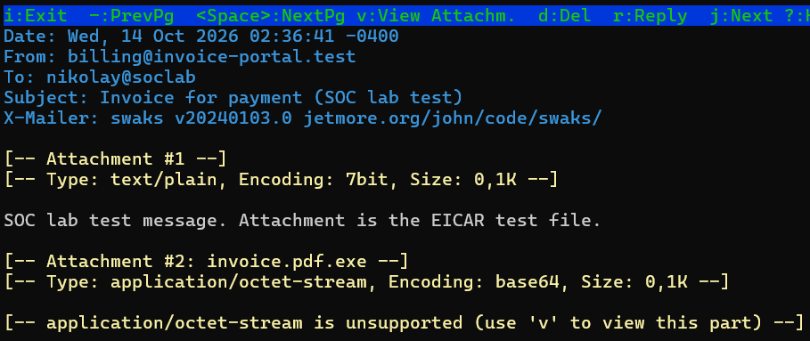

Рисунок 9 — Письмо с темой Invoice for payment и вложением invoice.pdf.exe

Затем он открывает список вложений и сохраняет файл в каталог загрузок, то есть делает ровно то, на что и рассчитана атака.

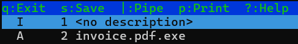

Рисунок 10 — Вложение invoice.pdf.exe в списке частей письма

---

## Шаг 8. Обнаружение

Как только файл оказывается в Downloads, FIM фиксирует его появление, и Wazuh создаёт алерт. Помимо этого, для проверки второго правила в каталог загрузок был помещён безобидный файл report.docx.exe, хэша которого в списке нет. На рисунке 11 видны оба срабатывания.

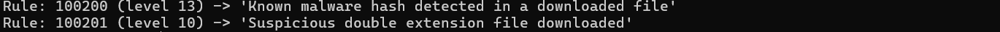

Рисунок 11 — Правило 100200 (уровень 13) для вложения и правило 100201 (уровень 10) для файла с двойным расширением

---

## Шаг 9. Дашборд

Те же события видны и в интерфейсе. В разделе Discover по запросу rule.id:100200 or rule.id:100201 отображаются оба файла. В карточке события есть путь к файлу, его хэши, режим обнаружения (realtime) и тип события (added).

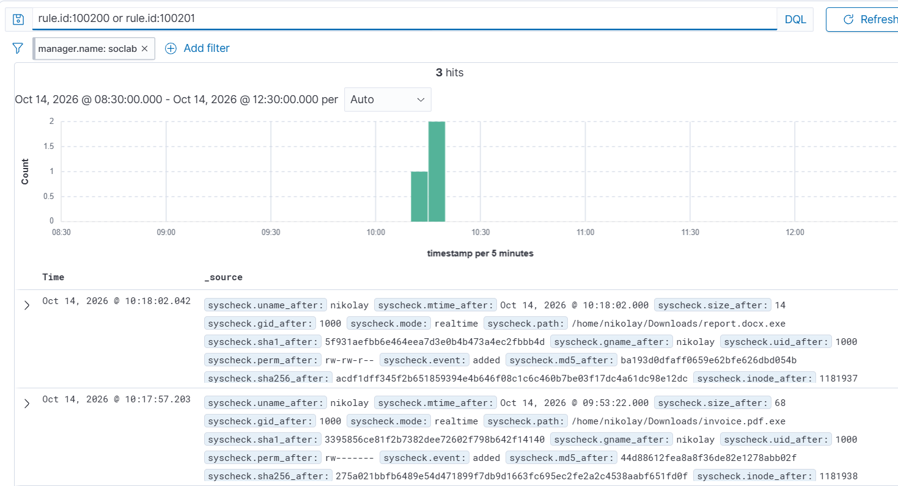

Рисунок 12 — События по файлам invoice.pdf.exe (MD5 44d88612fea8a8f36de82e1278abb02f) и report.docx.exe

Если раскрыть событие, видно номер правила, его уровень, группы и привязку к MITRE ATT&CK (рисунок 13).

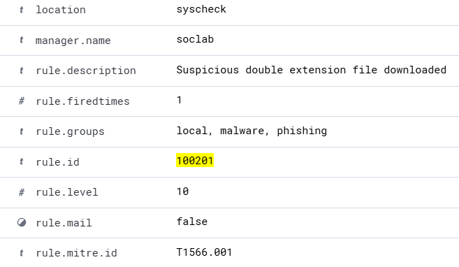

Рисунок 13 — Правило 100201, уровень 10, группы local, malware, phishing, техника T1566.001

---

## Действия аналитика L1 при таком алерте

Сам алерт это только начало. Ниже приведён порядок действий, который мы считаем правильным для аналитика первой линии:

1. Подтвердить срабатывание: путь к файлу, хэш, пользователь, время появления.
2. Найти источник файла. Для этого в журнале почтового сервера ищется письмо, доставленное незадолго до появления файла, и его отправитель.
3. Оценить масштаб: не получили ли такое же письмо другие пользователи и нет ли того же хэша на других узлах.
4. Изолировать угрозу: удалить файл или поместить его в карантин, заблокировать отправителя на почтовом шлюзе.
5. Эскалировать инцидент на L2, если файл был запущен или найден сразу на нескольких узлах.

---

## Выводы

В рамках сценария была воспроизведена фишинговая атака от отправки письма до сохранения вложения, и Wazuh её обнаружил. Если коротко, то результаты такие:

- вредоносное вложение обнаруживается прямо в момент сохранения на диск, за это отвечает FIM в режиме реального времени;
- сравнение хэша с CDB-списком позволяет однозначно опознать известный вредоносный файл и сразу присвоить алерту высокий уровень;
- правило по двойному расширению не просто дублирует проверку по хэшу, а дополняет её и ловит подозрительные файлы, которых в списке ещё нет;
- журнал почтового сервера связывает алерт с конкретным письмом и отправителем, так что у аналитика на руках вся цепочка событий.

Что можно сделать дальше? Подключить интеграцию с VirusTotal, чтобы проверять хэши неизвестных файлов, и настроить Active Response для автоматического удаления вредоносного файла.
